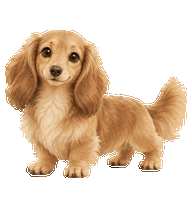
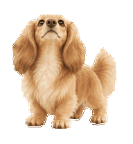
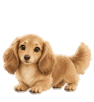
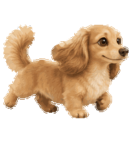

# 라떼 닥스훈트 · Latte Dachshund

라떼색의 보송한 장모, 긴 귀, 짧은 다리를 가진 Codex 데스크톱용 닥스훈트 펫입니다. 9가지 기본 동작과 16방향 시선을 담았습니다.



A fluffy, latte-colored longhaired dachshund asset pack for Codex desktop, with nine standard actions and sixteen gaze directions. Includes editable raster artwork and custom pet v2 metadata.

## 미리보기

| 주위를 살피기 | 점프하기 | 오른쪽으로 달리기 |
| --- | --- | --- |
|  |  |  |

## 들어 있는 것

- `spritesheet.webp`: 투명 배경의 스프라이트 시트
- `pet.json`: Codex custom pet v2 메타데이터
- `previews/`: 동작을 살펴볼 수 있는 GIF
- [docs/FORMAT.md](docs/FORMAT.md): 프레임 배치와 시선 방향 규칙

이 저장소는 수정 가능한 래스터 에셋과 메타데이터를 제공하는 에셋 팩입니다. 애플리케이션 소스 코드는 포함하지 않습니다. 이미지는 Codex에 내장된 imagegen으로 생성했으며, 픽셀 편집기로 수정할 수 있습니다.

## 설치

Codex 데스크톱의 **custom pet v2**를 지원하는 버전이 필요합니다.

1. [Releases](https://github.com/juicos61-arch/latte-dachshund/releases)에 배포된 ZIP이 있으면 내려받아 압축을 풀거나, 저장소를 복제합니다.

   ```sh
   git clone https://github.com/juicos61-arch/latte-dachshund.git
   cd latte-dachshund
   ```

2. `${CODEX_HOME:-$HOME/.codex}/pets/latte-dachshund` 폴더를 새로 만들고, 그 안에 `pet.json`과 `spritesheet.webp`를 함께 넣습니다. `CODEX_HOME`을 설정하지 않았다면 기본 위치는 `~/.codex/pets/latte-dachshund`입니다.

   아래 명령은 내려받거나 복제한 폴더에서 실행합니다. 같은 이름의 폴더나 심볼릭 링크가 이미 있으면 중단합니다.

   ```sh
   (
     pet_dir="${CODEX_HOME:-$HOME/.codex}/pets/latte-dachshund"

     if [ ! -f pet.json ] || [ ! -f spritesheet.webp ]; then
       printf '%s\n' 'pet.json과 spritesheet.webp가 있는 폴더에서 실행해 주세요.' >&2
       exit 1
     fi

     if [ -e "$pet_dir" ] || [ -L "$pet_dir" ]; then
       printf '%s\n' "기존 경로가 있어 설치를 중단했습니다: $pet_dir" >&2
       exit 1
     fi

     mkdir -p "${pet_dir%/*}" &&
       mkdir "$pet_dir" &&
       cp pet.json spritesheet.webp "$pet_dir/"
   )
   ```

3. 사용 중인 Codex에서 커스텀 펫 선택 기능을 제공한다면 **라떼 닥스훈트**를 선택합니다. 선택 화면의 구성과 지원 여부는 Codex 버전에 따라 다를 수 있습니다.

## 수정하기

스프라이트 시트의 크기와 프레임 배치를 유지한 채 이미지를 편집할 수 있습니다. 프레임은 192 × 208 픽셀이며, 전체 시트는 8열 × 11행입니다. [형식 문서](docs/FORMAT.md)를 참고해 동작별 프레임 수와 투명 배경을 유지해 주세요.

위쪽을 향하는 두 중간 시선은 좌우 차이가 미묘할 수 있습니다. 자세한 배치와 시선 규칙은 형식 문서에 기록했습니다.

## 라이선스

이 저장소의 에셋, 메타데이터, 문서는 [MIT 라이선스](LICENSE)로 배포합니다.
